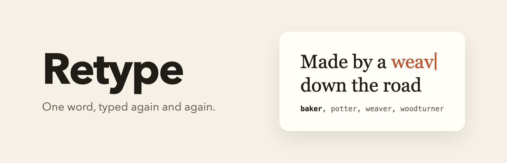
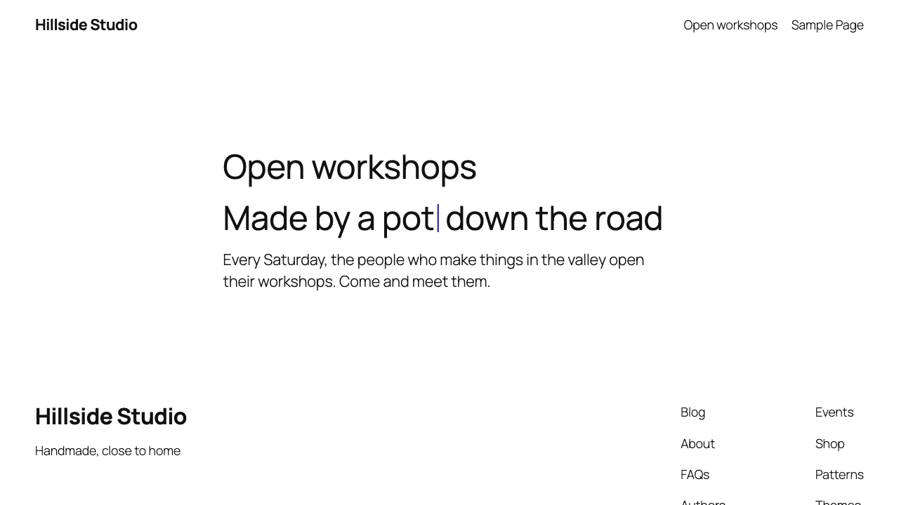

<p align="center">
  
</p>

<h1 align="center">Retype</h1>

<p align="center">A rich text format for the block editor: a word erases and retypes itself, letter by letter, with words from a list you type.</p>

<p align="center">
  <a href="https://github.com/Fyrins/retype/actions/workflows/ci.yml"></a>
  <a href="LICENSE"></a>
  
  
</p>

> Submitted to the WordPress.org plugin directory, awaiting review.

Select a word in a heading or a paragraph, choose **Retype** in the "More" dropdown of the formatting toolbar, type a few words separated by commas, and apply. On the front end the selected word is shown first, then erased and retyped with each word of the list, in a loop.

## What it looks like

<table>
<tr>
<td width="50%" valign="top">


<em>The popover, opened on a word that already carries the format</em>

</td>
<td width="50%" valign="top">



<em>On the site, halfway through typing "potter"</em>

</td>
</tr>
</table>

## Design decisions

### The saved markup is a plain span

```html
<span class="retype" data-retype-words="potter, weaver, woodturner">baker</span>
```

`class` and `data-*` are global attributes for KSES (`_wp_add_global_attributes()`), so the markup survives `wp_kses_post()` for authors without `unfiltered_html`, and the plugin never touches the allow list. Deactivating the plugin leaves the selected word in the sentence and invalidates no block: the format is markup the paragraph and heading blocks already accept.

### The front end only runs where the format is used

The script and the stylesheet are registered on `init` and enqueued from `render_block`, the first time a rendered block contains `data-retype-words`. The attribute is the marker rather than the class name, which a theme could plausibly use for something else. A page without the format carries no reference to either file. The script has no dependency, is deferred, and is printed in the footer.

### Accessibility, within the plugin's scope

No plugin makes a site accessible on its own. What this one does:

- The animated markup is built by the script. The original word goes in a visually hidden span, read once; the word being typed is `aria-hidden`. The heading's accessible name stays the original sentence, which was checked in an accessibility tree snapshot while the animation ran.
- Under `prefers-reduced-motion: reduce` nothing is animated and the caret is not drawn. The script listens to the media query, so turning the setting on while reading restores the original word straight away.
- Without JavaScript the span is a plain word.
- The loop stops while the tab is hidden (`visibilitychange`) and while the word is off screen (`IntersectionObserver`).

What it does not do: there is no pause control. A loop that starts on its own and runs for more than five seconds is the situation WCAG 2.2.2 (Pause, Stop, Hide) is about, so whether to animate a word, and where, is a decision for the site owner. The readme says so.

### The text follows the writing

The word being typed takes its real width at every letter, so the rest of the sentence moves along with it, the way it would if someone typed it. The word itself never breaks across two lines.

### Text only, never HTML

Every piece of text is inserted with `textContent`. The words come from a data attribute that an author typed, and they are never parsed as markup.

### Delays are code, not settings

`retype_delays` is the only configuration. There is no settings page and nothing in the database. The PHP side validates the filtered values and prints them only when they differ from the defaults, as a global defined before the script; the script validates the global again, since a theme can set it too. An inline script added `before` a deferred script keeps it deferred, which a test asserts on the printed tag.

### Why those minimum versions

**WordPress 6.6** is set by the editor bundle. `@wordpress/scripts` compiles JSX against the automatic runtime, so `build/editor.asset.php` lists `react-jsx-runtime`, and core registers that handle from 6.6 on (checked in `script-loader.php` of the 6.5 and 6.6 branches of wordpress-develop). Below 6.6 WordPress silently drops a script with a missing dependency, and the format would never appear. The other recent APIs are older: `useAnchor` is exported by `@wordpress/rich-text` since WordPress 6.1, and the `strategy` argument of `wp_register_script()` arrived in 6.3. A PHPUnit test asserts that every dependency of the editor script is registered by the WordPress it runs against.

**PHP 7.4** is WordPress's own floor, as reported by `https://api.wordpress.org/core/version-check/1.7/` (`php_version: 7.4` for 7.1.4). The code uses nothing newer than PHP 7.1 syntax (nullable return types); the declared value is a support commitment aligned with core. CI lints on 7.4 to 8.4 and runs PHPUnit on 7.4 and 8.3. `composer.json` pins the platform to PHP 7.4 so the development dependencies install there too.

## Filter

### `retype_delays`

Delays of the animation, in milliseconds.

```php
add_filter(
	'retype_delays',
	function ( $delays ) {
		$delays['type']  = 90;   // Per letter while typing. Default 40, kept between 10 and 2000.
		$delays['erase'] = 30;   // Per letter while erasing. Default 20, kept between 10 and 2000.
		$delays['hold']  = 2500; // Pause on each complete word. Default 1200, kept between 200 and 60000.

		return $delays;
	}
);
```

Missing keys keep their default. Numeric strings are accepted, values are rounded and confined to their bounds, and anything that is not a finite number, or a filter that returns something other than an array, falls back to the defaults.

A script of your own can set `window.retypeDelays` with the same keys before `build/view.js` runs. The same validation applies.

## Installing from this repository

The release on wordpress.org will be the supported install path. To run the development copy:

```bash
git clone git@github.com:Fyrins/retype.git
cd retype
composer install          # PHPCS and PHPUnit; the plugin has no runtime PHP dependency
npm install               # @wordpress/scripts
npm run build             # produces build/
```

Then symlink or copy the directory into `wp-content/plugins/retype`. The directory name matters: Plugin Check infers the text domain from it.

`npm run build` is required. `build/` is not in the repository, and without it the plugin activates but registers nothing.

## Checks

```bash
composer lint             # PHPCS: WordPress ruleset plus PHPCompatibilityWP
composer lint:php         # php -l over every PHP file
composer test             # PHPUnit against a real WordPress, see CONTRIBUTING.md
npm run lint:js           # ESLint with the WordPress config, plus Prettier
npm run lint:style        # Stylelint
npm run test:js           # Jest: word parsing and delay validation
```

Plugin Check runs on the **built package**, in a directory named exactly `retype`, never on the source tree. CONTRIBUTING.md has the commands.

## Translating

Translations are handled on translate.wordpress.org, not in this repository's package. The plugin directory asks hosted plugins not to ship `.po`, `.mo` or JSON files, so `languages/` holds only `retype.pot`, regenerated with `npm run i18n`.

`translations/retype-fr_FR.po` is a French translation kept for import on translate.wordpress.org once the plugin is approved. It is excluded from the package by `.distignore`.

The text domain matches the slug. There is no `load_plugin_textdomain()` call, and `wp_set_script_translations()` gets no path: just-in-time loading and the language packs cover both PHP and the editor script.

## Contributing

See [CONTRIBUTING.md](CONTRIBUTING.md).

## License

GPL-2.0-or-later. See [LICENSE](LICENSE) for the full text.
